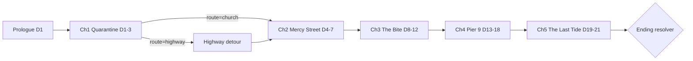

# STORYBOARD (main line, flexible)

**Premise:** Day 1, "the Rot" hits Marrow Bay (port city, 400k people). A looping radio broadcast promises **Haven**: "Pier 9, Day 21, limited manifest." There are **six seats**.
**Central question:** Who gets a seat, and who do you become to get one?
**Theme:** Reason vs instinct. Mercy vs survival. Order bought with fear vs trust earned with cost.
**Rule:** this is the spine. Scene IDs, flags and endings may change, but update this file in the same session.

## 1. Structure
| Act | Chapters | Days | Tension (1-10) | Job |
|---|---|---|---|---|
| I | Prologue, Ch1 | 1-3 | 4, 6 | Teach rules, establish honor, assemble the first party |
| II-A | Ch2 | 4-7 | 7 | Moral pressure: the Church; first betrayal of trust |
| II-B | Ch3 | 8-12 | 8 | **Midpoint twist:** the bite and the serum; armory and Reapers |
| II-C | Ch4 | 13-18 | 9 | **All-is-lost:** seat politics and the Screening |
| III | Ch5 | 19-21 | 10 | Siege, boarding, the truth about Haven, ending |

Every chapter ends on a **gate scene** (bottleneck) that reads variables, not path.

## 2. Canon facts (do not contradict)
- The Rot spreads by bite; fever 6-30 hours; "turning" takes minutes after death. Dead hunt by sound.
- Bells, engines, and screaming draw hordes. Quiet is survival.
- Haven is real and offshore. The broadcast loops from a relay on a lighthouse near Pier 9.
- Seats are checked at the **Screening** (a test for infection). Carriers are refused, and what happens to them is Calloway's secret.
- Ship departs **Day 21 at dusk**.
- **Nobody in Marrow Bay has a word for the dead who walk** (D23). No one has seen the idea in a story, so no one says "zombie" or "undead" (lint error). On Day 1 people say "the sick", "them", "that thing". The name **"the Rot" is first heard on the Haven broadcast** (Day 1 night); Juno notices that Haven had a name before the city had a problem (a seed for `c5.truth`). The player and the reader learn the rules by watching: they follow sound, they walk toward bells, they knock.
- **The knock** (three slow, a wait, three more; polite, patient) is the recurring sign: Dole's habit, the dream, the dead.
- Dole (3B) was bitten by a man wearing a St. Brigid's hospital wristband. Biscuit is Dole's dog.

## 3. Chapters

### Prologue: "Fever Dreams" (Day 1)
**Part 1, the intro: LIVE (`chapters/prologue.ts`, 23 scenes, ~1,100-1,300 words, about 6 minutes).** Story first (85:15, D22): 3 choice scenes, the rest narration. The player does not know what is happening and neither does anyone else (D23). It ends at night with the player asleep, handing over to the test chapter (`t.wake`) until M4 replaces it.
| Scene(s) | Beat | Key choice | Consequence / Echo |
|---|---|---|---|
| p.dream, p.wake, p.phone, p.tv, p.below, p.building | Cold open (bell, knock, your name); the fever breaks into a wrong silence; the city goes quiet in small ways; a woman turns her head toward a horn | n/a (background lines in wake / phone) | Reason -2, -3 (HUD pulse) |
| p.whine, **p.stairs** | A dog whines behind the fire door; Biscuit hangs from his leash, a woman in a bathrobe faces the wall below | Whisper him calm (Heart 7) / haul him loose (Grit 7) / shut the door | Biscuit joins (trust +15, Reason +5) or a noisy rescue (-1 HP, `stairs_noise`) or `biscuit_left` (Reason -5) |
| p.landing, p.bowl | Aftermath; the tag reads DOLE 3B; background pantry line (Food / Ammo / Meds) | n/a | callbacks on the rescue |
| p.knock, **p.dole** | The dream's knock at the door: Dole, bitten, burning up | Let him in (`mercy`) / keep the bolt on (`abandon`) / send him to St. Brigid's (`honest`, Reason -3) | `dole_inside` (**echo** `p.dole_knocks`, 2 scenes later, Reason -10: knocking from inside the bathroom), `dole_out`, `dole_sent` |
| p.hours, p.dusk, p.bell | The afternoon; the power dies; a church bell and a street of people walking toward it, then standing still | n/a | Reason -5; each Dole route has its own knock texture (inside, on the landing, silence) |
| p.static, p.voice, **p.radio**, p.night | The Haven loop names "the Rot"; Juno ("I don't have a word for them") says they follow noise and that Haven had the name first | Believe it / doubt it / switch it off | `heard_haven` + `haven_trust` / `haven_doubt` / `radio_off`; read by `t.wake`, `t.echo`, `t.gate` |

**Part 2 (M4, not written):** `p.street` (a father and child ask for food: share / refuse / rob; `share` / none / `steal`, witnessed; **echo:** the father reappears in Ch4) and `p.gate` (exit the building, Day 2 dawn). The test chapter stands in for it until then.

### Ch1: "Quarantine Zone" (Days 1-3, ~22 scenes)
Goal: find allies and supplies; first camp; choose route.
| Scene | Beat | Key choice | Consequence / Echo |
|---|---|---|---|
| c1.route | Streets blocked | Alley (Grit) / Rooftops (Wits) / Sewer (Heart: calm the rats?) | Resource and HP variance; flavor callbacks |
| c1.hospital | St. Brigid's ER overrun; Nora triages | Help patients (-Meds) / take Meds and go / lock the ward | `protect`/`steal`/`abandon`. **Echo:** survivors vouch (or accuse) you at Pier 9 |
| c1.nora | Recruit Nora | Convince / accept / refuse | Party +Nora (trust set by deeds) |
| c1.checkpoint | Calloway's deserter camp at a checkpoint | Trade info for ammo (lie or truth) / ignore | Seeds Calloway; `lie` or `honest` |
| c1.camp | First camp; bond with Biscuit/Nora (the Dole echo now plays inside the Prologue) | Eat / rest / talk | Reason, trust, food |
| c1.gate | Two ways to Pier 9: **Church** (Mercy St, safe but strict) or **Highway** (fast, deadly) | Route choice | Flag `route`. Highway gives a detour scene, then merges into Ch2 |

### Ch2: "Mercy Street" (Days 4-7, ~22 scenes)
Goal: the Congregation shelter; control vs conscience.
| Scene | Beat | Key choice | Consequence / Echo |
|---|---|---|---|
| c2.rules | Hart's rules: work for food | Accept / negotiate (Heart) / sneak | Trust with Hart |
| c2.list | The Ration List ranks people by "worthiness" | Comply / sabotage / confront | Congregation standing; `honest`/`lie` |
| c2.brick | Brick locked in basement for stealing | Free him / trade labor for him / leave | Brick loyalty or resentment. If freed while witnessed, Hart hostile |
| c2.juno | Juno found in bell tower with a radio | Befriend / use / confront | Party +Juno (conditions) |
| c2.crypt | **Secret:** Hart keeps his turned wife alive | Expose publicly / mercy-kill her / keep the secret | Large honor swing. **Echo (secret):** Hart appears in Ch4/5 as ally, enemy, or blackmailer |
| c2.toll | Night: the bell is rung, a horde comes | Ring to lure them away (lose some congregants) / barricade / flee | `sacrifice` or `abandon`. **Nora is bitten** (how: shielding a child, Biscuit, or you) |
| c2.gate | Leave the church (as hero, exile, or arsonist) | n/a | Flags: `church_fate`, `hart_fate` |

### Ch3: "The Bite" (Days 8-12, ~22 scenes)
Goal: armory depot, the serum, Reapers. Midpoint twist: Nora's infection and the single dose.
| Scene | Beat | Key choice | Consequence / Echo |
|---|---|---|---|
| c3.signs | Nora's fever, sweating, hidden bandage | Confront privately / publicly / ignore | `honest`/`betray`; Nora trust swing |
| c3.depot | Armory depot; Calloway runs it | Barter (info/ammo) / steal / threaten | Ammo, Calloway trust |
| c3.reapers | Silas Crane's ambush | Parley (honor-gated) / fight (Grit) / sneak (Wits) | **Low honor:** Silas offers a partnership. **High honor:** Silas mocks you but respects the party. Brick recognizes his brother |
| c3.serum | **One dose** of the slowing serum found | Give to Nora / keep for self / trade to Calloway / destroy | Huge `sacrifice`/`steal`/`betray` branch; sets `rot_rate` |
| c3.fate | Nora's path | Keep her in the party hidden / quarantine her / send her away / mercy-kill | Defines Ch4 Screening risk |
| c3.gate | Road to the pier opens | n/a | Flags: `nora_status`, `serum_used`, `silas_deal` |

### Ch4: "Pier 9" (Days 13-18, ~22 scenes)
Goal: get a seat. Three routes, each costly. Warden Vera Kline controls the manifest.
| Route | How | Cost |
|---|---|---|
| **Respect** | Earn deeds with dock families; get witnesses to vouch (needs honor ≥ 21) | Time; share resources; refuse shortcuts |
| **Fear** | Back Silas or intimidate Vera's guards (honor ≤ -21) | Trust of companions; Reapers owe you |
| **Cunning** | Forge manifest via Juno / Dockworker shortcut / blackmail with Hart's secret | Risk of exposure; Wits checks |

| Scene | Beat | Key choice | Consequence / Echo |
|---|---|---|---|
| c4.line | The queue and Vera's "tax" | Pay / refuse / bribe | Resources, Vera fear/trust |
| c4.father | Prologue father returns | Help / ignore / use | Echo payoff from p.street |
| c4.families | Dock families side quest | Help / skip | `protect`; allies for Ch5 |
| c4.silas | Silas offers: sabotage Vera, get a seat | Accept / refuse / double-cross | Fear route; Brick conflict |
| c4.brother | Juno finds her brother | Reunite / lie / tell truth | Juno trust |
| c4.screen | **The Screening** (all-is-lost) | Hide Nora / reveal / sacrifice yourself / expose Vera | Nora, Vera, seat count |
| c4.gate | Manifest is set | n/a | Flags: `seats`, `route_used` |

### Ch5: "The Last Tide" (Days 19-21, ~22 scenes)
Goal: siege, boarding, the truth, the final choice.
| Scene | Beat | Key choice | Consequence / Echo |
|---|---|---|---|
| c5.siege | Reapers hit the gates | Defend gate / flood the lower deck / negotiate | Who holds the line depends on alive companions + trust |
| c5.hold | Companion roles: Brick holds the door, Juno broadcasts, Calloway blows the bridge, Hart's flock rallies | Assign roles | Each role has a success/fail by trust |
| c5.board | Manifest boarding; names called | Who sits: you decide | Final party size, honor swing |
| c5.truth | Calloway tells the truth about Haven: screening is selection, carriers are taken for study (cure or disposal, unclear) | Believe / confront / board anyway | Reason and ending gate |
| c5.final | Gangway choice: sail / stay and hold the pier / lead the crowd out | Final choice | Ending resolver |

## 4. Endings (first matching rule wins; evaluated top to bottom)
| # | Ending | Condition (sketch) | Feel |
|---|---|---|---|
| E1 | **Beacon** | honor ≥ 61, ≥ 3 allies alive with trust ≥ 30, choose "lead" | Hope; people follow you to a new shore |
| E2 | **Warden of the Dead** | honor ≤ -61, fear route used | You rule the pier; hollow, safe, alone |
| E3 | **Broken Reason** | Reason < 20 at final | Fragmented text; ambiguous reality |
| E4 | **Rot Within** | you or Nora turned/rot ≥ 100, board or stay | Haven's "treatment"; bittersweet |
| E5 | **Last Seat** | default sail path, moderate honor | Escape with 1-2; cost remembered |
| E6 | **The Lighthouse** (secret) | stay at pier with Biscuit + Juno alive + `broadcast_changed` | Quiet hope; you become the new signal |

Each ending has 1 screen of epilogue per surviving companion (data-driven from `fate` flags).

In data (`src/story/endings.ts`, live since M1 s3) the ids are `beacon`, `warden_of_the_dead`, `broken_reason`, `rot_within`, `lighthouse`, `last_seat`, and E6 sits before E5 so the unconditional default is last. Allies for Beacon are Nora, Brick, Juno, Hart, Calloway (alive, trust >= 30). The flags they read (`final_lead`, `final_stay`, `route_fear`, `nora_turned`, `broadcast_changed`) are in `story/flags.ts`. Death is a separate ending id, `death`. The Ending screen titles are in `src/ui/strings.ts` (`endings`): rename an ending there too.

## 5. Flexible-change protocol
1. Change this file first (new beat or ending).
2. Update `flags.ts` registry and any ending conditions.
3. Run `npm run lint:story` (checks every referenced scene/flag).
4. Note the change in `HANDOFF.md` ("Story changes").
